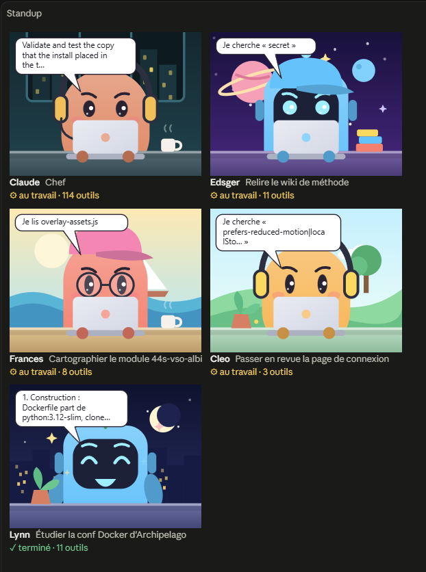

# Standup des sous-agents

Un mod pour Claude Code qui montre les sous-agents de la session en visio, dans un panneau de
l'application Claude Desktop : chacun à son bureau, avec une bulle qui dit ce qu'il fait, puis le
début de son rapport.



Adapté d'[agent-standup](https://github.com/Atoll92/agent-standup), d'Arthur, dont il reprend les
personnages et les décors. agent-standup est un serveur local qui relit les journaux de toutes vos
sessions et les affiche dans un navigateur ; ce mod vit dans la session elle-même : pas de serveur,
pas de navigateur, rien à lancer.

## Ce qu'il affiche

- Une tuile pour l'agent principal, « Claude », le chef, puis une par sous-agent, avec un prénom et
  sa mission.
- Le personnage s'anime : il respire et cligne des yeux, tape au clavier quand il travaille, et se
  couvre d'étoiles quand il a fini.
- Sa bulle dit l'action en cours (« Je lis client.js », « Je cherche « retry » »), puis le début de
  son rapport.
- Sous l'image : son état et le nombre d'outils utilisés.
- Un sous-agent fini quitte le panneau au premier message envoyé deux minutes après sa fin.
- Dans un terminal, le panneau passe en texte : une ligne par agent.

## Installation

Cinq minutes, dans un terminal. Pas besoin de se connecter : l'installation ne fait que
télécharger le mod depuis ce dépôt.

### 1. Avoir la commande `claude`, à jour

Le mod s'installe avec la commande `claude`. Vérifiez si vous l'avez :

```
claude --version
```

Il faut une version récente, car les mods sont encore une fonction expérimentale : le mod est testé
de la 2.1.295 à la 2.1.299. Si la vôtre est plus ancienne, `claude update` la met à jour.

Si la commande est introuvable, installez-la avec l'installeur officiel, sans droits
d'administrateur, puis ouvrez un nouveau terminal :

- Windows, dans PowerShell : `irm https://claude.ai/install.ps1 | iex`
- macOS ou Linux : `curl -fsSL https://claude.ai/install.sh | bash`

Les autres méthodes sont dans la [documentation d'installation](https://code.claude.com/docs/en/setup).

**Sous Windows, sans rien installer :** l'application de bureau embarque sa propre commande
`claude`, toujours à la version de l'application. Dans PowerShell, retrouvez-la avec :

```powershell
$claude = (Get-ChildItem "$env:APPDATA\Claude\claude-code\*\*\claude.exe" | Sort-Object { [version]$_.Directory.Parent.Name } | Select-Object -Last 1).FullName
```

puis remplacez `claude` par `& $claude` dans les commandes qui suivent. Ce chemin n'est pas
documenté et peut changer avec une mise à jour de l'application.

### 2. Installer le mod

```
claude plugin marketplace add Jeace/claude-desktop-subagent-standup
claude plugin install subagent-standup@subagent-standup
```

La première commande déclare ce dépôt comme catalogue de plugins, la seconde installe le mod pour
votre utilisateur. Pour ne l'activer que dans un projet, lancez les deux commandes depuis le
dossier du projet, en ajoutant `--scope local` à chacune.

`claude plugin list` doit ensuite montrer `subagent-standup@subagent-standup`, activé.

### 3. L'essayer

Dans l'application de bureau, ouvrez une **nouvelle** session : un mod se charge au démarrage d'une
session, pas dans celles déjà ouvertes. Envoyez un message : le panneau s'ouvre dès que Claude se
met au travail. Pour voir toute l'équipe, demandez une tâche qui lance des sous-agents, par exemple
« Lance deux sous-agents : l'un résume le README, l'autre liste les fichiers du projet ».

### Mettre à jour, retirer

```
claude plugin marketplace update subagent-standup
claude plugin update subagent-standup@subagent-standup
```

Pour le retirer : `claude plugin uninstall subagent-standup@subagent-standup`.

### En cas de souci

- **`claude` introuvable juste après l'installation** : ouvrez un nouveau terminal ; sinon, voir
  [la correction du PATH](https://code.claude.com/docs/en/troubleshoot-install).
- **Le panneau ne s'ouvre pas tout seul** : fermé à la main, il ne revient qu'avec `/standup`.
  Sinon, l'application l'a gardé caché, le plus souvent faute de largeur : tapez `/standup`, sa
  réponse dit pourquoi il n'était pas venu.
- **`/standup` est inconnu** : la session était ouverte avant l'installation, ouvrez-en une
  nouvelle. Mettez aussi l'application de bureau à jour : c'est son moteur qui fait tourner le mod.
- **`marketplace add` refusé** : vérifiez l'orthographe du dépôt. Si votre organisation restreint
  les catalogues de plugins, l'installation se décide avec son administrateur.

## Utilisation

- Le panneau s'ouvre tout seul dès que Claude se met au travail, sans attendre de sous-agent : à
  votre message, ou au début d'un tour lancé sans vous (une notification, une reprise).
- Ouvert à votre message, il compte comme demandé : l'application l'affiche quelle que soit la
  largeur de la fenêtre. Ouvert par un tour lancé sans vous, il faut une fenêtre assez large : en
  dessous, l'application le garde caché, et une notification invite à taper `/standup`.
- `/standup` l'ouvre à la demande, quelle que soit la largeur de la fenêtre.
- Fermé à la main, il ne se rouvre plus tout seul, jusqu'au prochain `/standup`.
- C'est l'application qui décide de la largeur du panneau : tirez son bord pour la régler, jusqu'à
  un seul personnage de large.

## Ce qu'il fait de vos données

- Rien ne quitte votre machine : aucun appel réseau, aucune lecture de fichier. Le mod reçoit les
  événements de la session (un sous-agent qui démarre, un outil appelé, un tour qui finit) et les
  dessine.
- Il observe sans rien bloquer ni modifier : chacun de ses hooks passe la main tel quel.
- Une commande shell n'est jamais affichée, seulement sa description : une commande peut porter un
  jeton.
- Le chemin d'un fichier lu ou modifié est réduit à son nom.

## Limites

- Il ne voit que la session où il tourne : ni les autres sessions, ni les autres projets.
- Pas de voix, contrairement à agent-standup.
- La largeur des bulles est estimée : l'image ne connaît pas la police de l'application, et un
  texte peut déborder un peu.

## Développement

```
hooks/register.tsx   les hooks : sous-agents, outils, fins de tour, et le dessin du panneau
hooks/cast.ts        personnages, décors et bulle, en SVG
hooks/describe.ts    la réplique de chaque outil, le résumé du rapport
types/index.d.ts     l'état que garde le mod
tests/               les tests
```

- Charger le mod depuis ce dossier : `claude --plugin-dir <dossier>` ; pour l'application de
  bureau, nommer le dossier dans `CLAUDE_CODE_PLUGIN_DIRS`, dans le bloc `env` de
  `~/.claude/settings.json`.
- Vérifier : `claude plugin validate .` puis `claude plugin test .`.
- Les types : Claude Code dépose ses déclarations dans `.claude-plugin/types/` quand il charge le
  mod depuis un dossier ; ensuite `npx -p typescript tsc -p .`.

## Licence

MIT, voir [LICENSE](LICENSE). Les personnages et les décors viennent d'agent-standup,
© 2026 Arthur, sous licence MIT.
